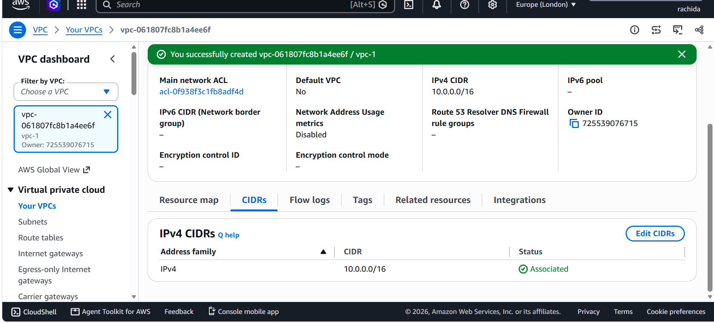
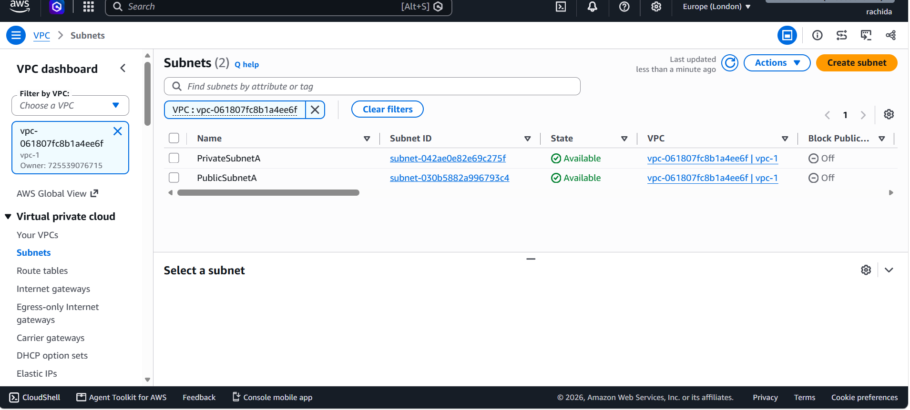
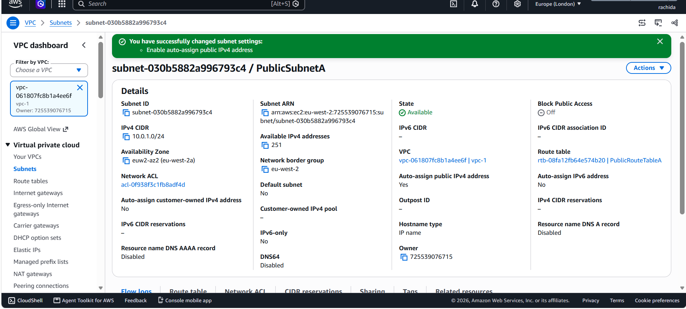
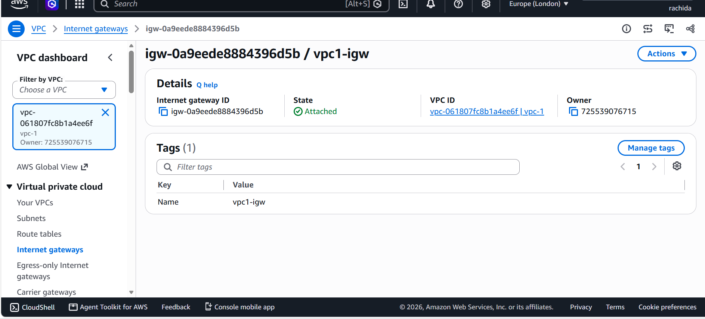
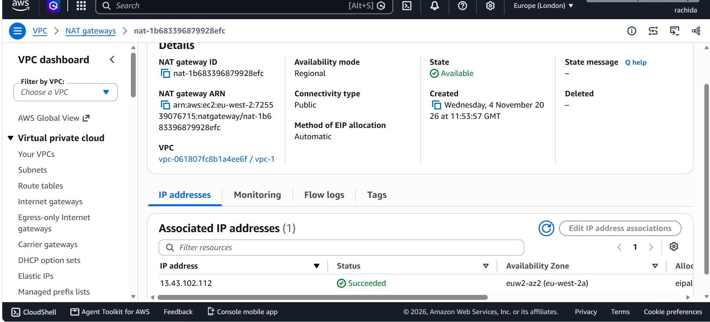
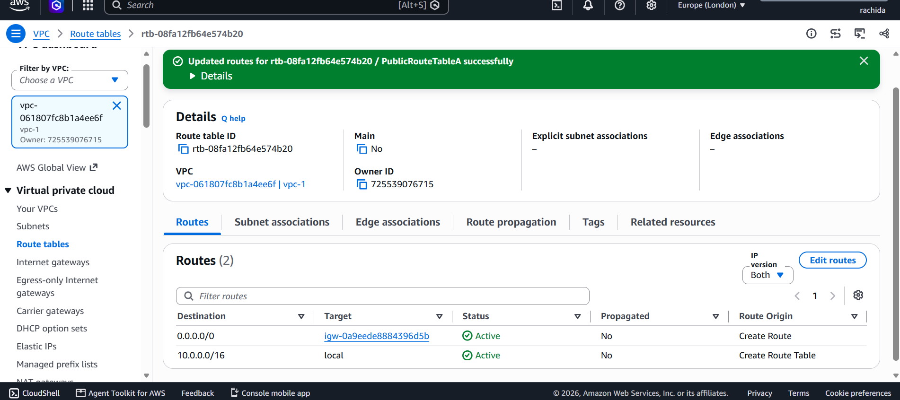
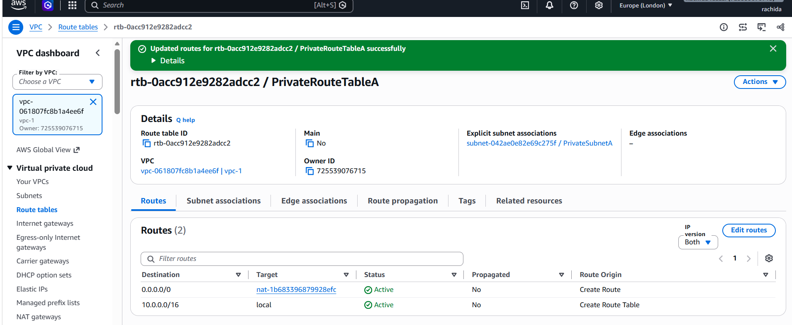
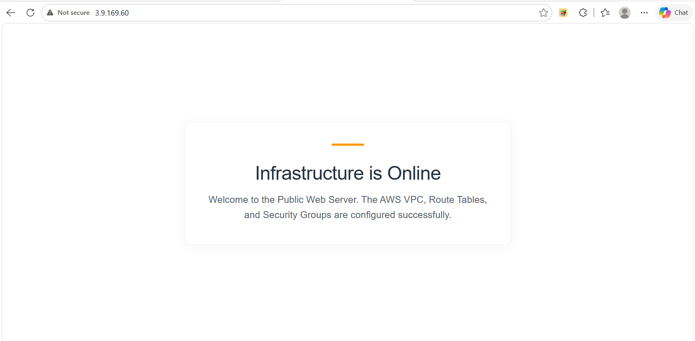
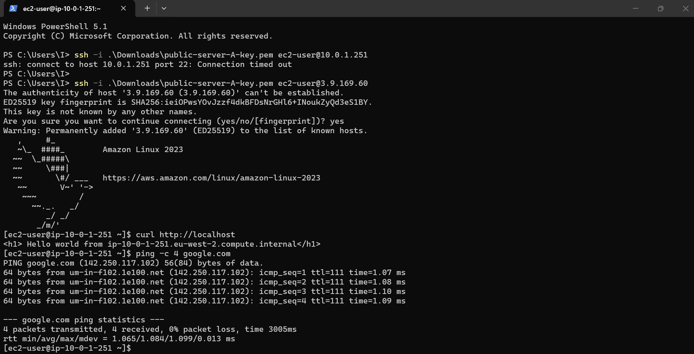

<p align="center">
  
  
  
  
</p>

<p align="center">
AWS VPC & Bastion Host Architecture
  
<p align="center">
  <b>A hands-on AWS networking project demonstrating secure cloud infrastructure, subnet isolation, traffic routing, and controlled administrative access.</b>
</p>

---

##  Project Overview

This project showcases the design and deployment of a custom **Amazon Virtual Private Cloud (VPC)** from the ground up.

The architecture separates public-facing resources from private workloads, using Internet and NAT Gateways to manage network connectivity. A Bastion Host provides a controlled entry point for securely accessing instances within the private subnet.

The project explores essential AWS networking and security concepts through practical implementation, configuration, and verification.

###  Key Features

- **Custom VPC:** Dedicated network environment with a defined IPv4 address range.
- **Public & Private Subnets:** Separation of internet-facing and internal resources.
- **Internet Gateway:** Enables internet connectivity for public resources.
- **NAT Gateway:** Provides outbound internet access to private instances without assigning them public IP addresses.
- **Bastion Host:** Acts as a secure administrative jump server.
- **Security Groups:** Controls inbound and outbound traffic between resources.
- **CloudWatch Monitoring:** Enables detailed EC2 instance monitoring.

---

## Architecture Overview

The infrastructure consists of one custom VPC, two subnets, three EC2 instances, and the necessary networking components to control traffic flow.

### Network Configuration

| Component | Configuration | Purpose |
|:---|:---|:---|
| VPC | `10.0.0.0/16` | Isolated AWS network |
| Public Subnet | `10.0.1.0/24` | Hosts internet-facing instances |
| Private Subnet | `10.0.2.0/24` | Hosts internal workloads |
| Internet Gateway | `vpc1-igw` | Public internet connectivity |
| NAT Gateway | `nat-1b683396879928efc` | Outbound access for private resources |
| Bastion Host | Public Subnet | Secure SSH entry point |
| EC2 Instances | 3 instances | Compute resources across both subnets |

### Network Design Principles

| Network Component | Configuration |
|:---|:---|
| Public Subnet | Auto-assign public IPv4 enabled |
| Private Subnet | No public IP addresses assigned |
| Public Routing | Default route through Internet Gateway |
| Private Routing | Default route through NAT Gateway |
| Administrative Access | SSH through Bastion Host |

---

## Project Structure

```text
01-vpc-bastion-host/
│
├── screenshots/
│   ├── 1-vpc-created.png
│   ├── public-private-subnets.png
│   ├── public-subnet.png
│   ├── igw-attached.png
│   ├── 4-nat-gateway.png
│   ├── 5-public-route-table.png
│   ├── private-route-table.png
│   ├── monitoring added.png
│   └── monitoring proof.png
│
└── README.md
```

---

## Implementation Walkthrough

### 01. VPC & Subnet Configuration

The foundation of the architecture was created by deploying a custom VPC and dividing its address space into public and private subnets.

**Configuration steps:**

1. Created a custom VPC named `vpc-1` using IPv4 CIDR `10.0.0.0/16`.
2. Created `PublicSubnetA` with CIDR `10.0.1.0/24` in Availability Zone `euw2-az2`.
3. Created `PrivateSubnetA` with CIDR `10.0.2.0/24`.
4. Enabled automatic public IPv4 assignment on the public subnet.
5. Kept public IP assignment disabled for private resources.

**Deployment evidence:**







---

### 02. Internet Connectivity

To establish controlled internet connectivity, an Internet Gateway and a NAT Gateway were deployed.

**Internet Gateway (IGW)**

- Created an Internet Gateway named `vpc1-igw`.
- Attached it to the custom VPC (`vpc-1`).
- Configured it to provide internet connectivity to resources in the public subnet through the public route table.



**NAT Gateway & Elastic IP**

- Deployed a NAT Gateway (`nat-1b683396879928efc`) inside `PublicSubnetA`.
- Allocated and associated an Elastic IP address.
- Enabled private subnet resources to initiate outbound internet connections without being directly accessible from the internet.



---

### 03. Route Table Configuration

Separate route tables were configured to control how traffic moves between the public and private subnets.

**Public Route Table**

- Name: `PublicRouteTableA`
- ID: `rtb-08fa12fb64e574b20`
- Associated with: `PublicSubnetA`
- Default route (`0.0.0.0/0`) points to the Internet Gateway.



**Private Route Table**

- Name: `PrivateRouteTableA`
- ID: `rtb-0acc912e9282adcc2`
- Associated with: `PrivateSubnetA`
- Default route (`0.0.0.0/0`) points to the NAT Gateway.



**Routing Summary**

| Route Table | Destination | Target | Associated Subnet |
|:---|:---|:---|:---|
| Public Route Table | `0.0.0.0/0` | `igw-0a9eede8884396d5b` | `PublicSubnetA` |
| Private Route Table | `0.0.0.0/0` | `nat-1b683396879928efc` | `PrivateSubnetA` |

This configuration ensures that public resources can communicate directly with the internet, while private instances rely on the NAT Gateway for outbound connectivity.

---

### 04. EC2 Instance Deployment

Three EC2 instances were deployed across the two subnets to demonstrate different access requirements.

| Instance | Subnet | Public IP | Role |
|:---|:---|:---|:---|
| Bastion Host-A | Public | Enabled | Administrative jump server |
| Public-server-A | Public | Enabled | Public-facing workload |
| Private-server-A | Private | Disabled | Internal workload |

The Bastion Host acts as the controlled access point for administrators who need to connect to the private instance.

---

### 05. Security Groups & Monitoring

**Security Group Configuration**

Security groups were configured to restrict access according to each instance's role.

| Security Group | Protocol | Port | Source | Purpose |
|:---|:---|:---|:---|:---|
| Public Server SG | TCP | 22 | Custom admin IP | SSH administration |
| Public Server SG | TCP | 80 | `0.0.0.0/0` | HTTP access |
| Private Server SG | TCP | 22 | Bastion Security Group | Restricted SSH access |

The private instance does not accept SSH connections directly from the public internet. Administrative access is routed through the Bastion Host.

**CloudWatch Detailed Monitoring**

Detailed monitoring was enabled across the EC2 instances to provide additional visibility into infrastructure performance.

Metrics monitored include:

- CPU utilisation
- Network activity
- Instance performance

**Monitoring evidence:**


---

## Verification & Testing

Following deployment, connectivity and accessibility tests were performed to verify that the public EC2 instance was running correctly and that the network configuration supported the expected traffic flow.

### 01. Public Web Server Accessibility

Accessed the public EC2 web server through its Elastic/public IPv4 address using a web browser.

**Verification results:**
- Successfully accessed the web server at `3.9.169.60`.
- Confirmed that the HTTP service was responding.
- Verified that the custom landing page displayed the message **"Infrastructure is Online"**.
- Confirmed that the VPC, route tables, and security group configuration supported external HTTP access.



<sub>Figure 1: Successful access to the public EC2 web server through its public IPv4 address.</sub>

### 02. SSH Access & Instance Connectivity

Established an SSH connection from a local Windows PowerShell terminal to the public EC2 instance using its private key (`.pem`).

**Verification results:**
- Attempted an SSH connection using the instance's private IP (`10.0.1.251`), which timed out from the local machine.
- Successfully established SSH access using the public IP address (`3.9.169.60`).
- Authenticated using the EC2 private key and accessed the Amazon Linux 2023 instance.
- Executed `curl http://localhost` to verify that the local Apache web server was responding.

The successful `curl` request returned the instance's custom HTML response:

```html
<h1> Hello world from ip-10-0-1-251.eu-west-2.compute.internal</h1>
```

**Outbound Internet Connectivity**

While connected to the EC2 instance, executed:

```bash
ping -c 4 google.com
```

All four ICMP packets were successfully received, with **0% packet loss**, confirming outbound internet connectivity and DNS resolution.



<sub>Figure 2: Successful SSH authentication, local web server verification using curl, and outbound internet connectivity testing.</sub>

The public EC2 instance was successfully accessed and tested. HTTP availability, SSH authentication, local web server functionality, and outbound internet connectivity were all verified.

---

**Security Considerations**

This project also demonstrates several important cloud security practices:

- Avoid exposing private EC2 instances through public IP addresses.

- Restrict SSH access to trusted administrator IP addresses.

- Allow private server SSH access only from the Bastion Host security group.

- Use private subnets for workloads that do not require direct inbound internet access.

- Monitor infrastructure performance to support operational visibility.

---

**Project Outcome**

Successfully designed and deployed a functional AWS VPC architecture featuring public and private networking, controlled internet connectivity, and secure administrative access through a Bastion Host.

The project provided practical experience with AWS networking fundamentals and demonstrated how multiple cloud services work together to build a structured and more secure infrastructure environment.

<p align="center">
  <b>Built with ☁️ AWS | Focused on Networking, Security & Cloud Infrastructure</b>
</p>
